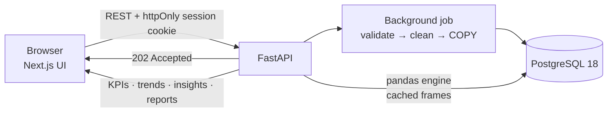

<div align="center">
# Creatrix Pulse
 
**Business intelligence, simplified.**
Upload a sales file and get dashboards, insights and reports in seconds.
 
[**Live demo → creatrixpulse.vercel.app**](https://creatrixpulse.vercel.app)
 


 
</div>
---
 
## Overview
 
Creatrix Pulse turns a plain CSV or Excel export of your sales into an interactive analytics workspace. You upload a
file, map its columns once, and the platform validates and cleans every row, stores it in PostgreSQL and computes
KPIs, trends, product, customer and profit analytics with pandas. It also writes plain-language **insights** for you
(an unusual sales week, a product losing ground, the category with the thinnest margin) and exports **reports**.
 
The repository is a monorepo:
 
| Folder | What it is |
|---|---|
| [`frontend/`](frontend) | Next.js application (the UI). Runs on built-in demo data until you connect the API. |
| [`backend/`](backend) | FastAPI + PostgreSQL + pandas API. Detailed documentation: [`backend/README.md`](backend/README.md). |
| [`sample-data/`](sample-data) | A ready-to-upload sample file (24 months of retail sales). |
 
## Features
 
| | |
|---|---|
| **Upload** | CSV, `.xlsx` and legacy `.xls` up to 25 MB; guided column mapping; clear, row-level error messages; live processing progress |
| **Overview** | Revenue, orders, units, average order value, profit and margin with period-over-period change; revenue trend; top products; category and region breakdowns |
| **Sales** | Day / week / month trends, previous-period overlay, category trend |
| **Products** | Best and weakest performers, share of revenue, growth versus the previous period, margin |
| **Customers** | New vs returning, purchase frequency, customer segments (Champions, Loyal, Returning, One-time), distribution by region |
| **Finance** | Revenue vs cost vs profit, margin by category |
| **Insights** | Automatic findings: revenue change, concentration risk, best and worst movers, unusual weeks (z-score), regional gaps, thin margins, repeat-purchase rate |
| **Data Explorer** | Search, sort, filter and inspect the cleaned records |
| **Reports** | Pick metrics and a period, preview, save and download as CSV or JSON |
| **Datasets & settings** | Upload history, replace or delete a dataset, display currency and locale (INR, USD, EUR, GBP) |
| **Filters everywhere** | Date presets and custom ranges, comparison period, category and region filters |
 
## How it works
 

 
1. **Upload.** The file and the column mapping are posted; the API answers immediately and keeps working in the background.
2. **Validate and clean.** Dates, numbers (`₹1,299.50`, `12,34,567.89`, `(50.00)`), encodings and delimiters are
   normalised. Bad rows are never dropped silently: the upload fails with the column, the count and examples.
3. **Store.** Clean rows are bulk-loaded into PostgreSQL with `COPY`. The processing page shows real progress.
4. **Analyze.** pandas computes every dashboard from an in-memory frame of the dataset, so changing a filter is instant.
## Tech stack
 
| Layer | Technology |
|---|---|
| Frontend | Next.js 16 · React 19 · TypeScript 5.9 · Tailwind CSS 4 · TanStack Query 5 · Zustand 5 · Recharts 3 · Zod 4 · React Hook Form |
| Backend | Python 3.15 · FastAPI 0.162 · Pydantic 2.14 · SQLAlchemy 2.1 (async) · psycopg 3 · Alembic · uvicorn |
| Data | PostgreSQL 18 · pandas 3.1 · NumPy · PyArrow · python-calamine (Excel) |
| Security | Argon2id password hashing · server-side sessions in an httpOnly cookie · CSRF origin check · per-user data isolation |
| Quality | pytest (400+ tests) · ruff · mypy `--strict` · a contract test that type-checks real API responses against the frontend's TypeScript types |
 
## Getting started
 
### Prerequisites
 
* **Node.js 22+** (frontend)
* **[uv](https://docs.astral.sh/uv/)** (backend; it installs Python 3.15 for you)
* **PostgreSQL 18**, easiest through Docker Desktop
### 1. Frontend only (demo mode)
 
```bash
cd frontend
npm install
npm run dev          # http://localhost:3000
```
 
With no environment variables the app runs on **built-in demo data**, so you can explore every page without a
backend. Demo mode does not read the contents of files you upload; to analyze your own data, run the backend below.
 
### 2. Full stack (real uploads, PostgreSQL, pandas)
 
**Backend**
 
```bash
cd backend
docker compose up -d db             # PostgreSQL 18 on localhost:5432
uv sync                             # installs the locked dependencies (and Python 3.15 if needed)
cp .env.example .env                # Windows: copy .env.example .env
uv run alembic upgrade head         # create the tables
uv run python -m app --reload       # API on http://localhost:8000  ·  docs on /api/docs
```
 
> **Windows:** start the API with `python -m app` as above. Plain `uvicorn app.main:app` fails on Windows because
> psycopg's async mode cannot use the default Windows event loop; the launcher picks a compatible one. (`uv` itself:
> `winget install astral-sh.uv`.)
 
**Frontend** — create `frontend/.env.local`:
 
```bash
NEXT_PUBLIC_USE_MOCKS=false
NEXT_PUBLIC_API_BASE_URL=http://localhost:8000/api
```
 
```bash
cd frontend
npm run dev                         # http://localhost:3000
```
 
Register an account, open **Upload** and choose `sample-data/sales-sample.csv`.
 
> Open the app and the API with the **same hostname** (`localhost` with `localhost`, or `127.0.0.1` with `127.0.0.1`).
> The login cookie is `SameSite=Lax`, and browsers treat the two hostnames as different sites.
 
### Configuration
 
| Where | Variable | Purpose |
|---|---|---|
| frontend | `NEXT_PUBLIC_USE_MOCKS` | `false` talks to the real API; anything else uses demo data (default) |
| frontend | `NEXT_PUBLIC_API_BASE_URL` | API root, e.g. `http://localhost:8000/api` (default `/api`) |
| backend | `DATABASE_URL` | PostgreSQL connection string |
| backend | `CORS_ORIGINS` | Allowed frontend origins (default `http://localhost:3000`) |
| backend | `ENVIRONMENT` | `production` enables secure cookies and hides `/docs` |
| backend | `MAX_UPLOAD_MB` | Upload limit (default 25) |
 
The full list is in [`backend/.env.example`](backend/.env.example).
 
## Sample dataset
 
[`sample-data/sales-sample.csv`](sample-data/sales-sample.csv) is a synthetic retail dataset in Indian rupees:
**16,346 rows · 11,084 orders · 3,050 customers · 1 Nov 2024 – 31 Oct 2026 · ₹3.57 crore revenue**. Its headers
(`Order ID, Order Date, Product, Category, Region, Customer ID, Quantity, Revenue, Cost`) are recognised
automatically by the mapping step. It is shaped so every page has something to show:
 
| Look at | What you will find |
|---|---|
| Sales → daily | A short **site outage** on 13–14 May 2026 (₹0 days) and a **spring sale** week, 16–22 Mar 2026, at about 3x a normal week |
| Overview → insights | An **unusual spike** week, **revenue concentrated** in a few products (top 3 ≈ 47%), **East** as the weak region (≈ 13%) |
| Finance | **Electronics** has the thinnest margin (≈ 16%) while Beauty & Personal Care is the healthiest (≈ 63%) |
| Products → last 90 days vs previous | Seasonal movers such as **Winter Jacket** and **Sunscreen** |
| Customers → last 90 days | About 1,400 active customers, roughly 400 of them new and 1,000 returning (over *all time* every customer counts as "new", by definition) |
 
Use **Last 90 days** with **Previous period** to see comparisons. Regenerate or resize the file with
`python backend/scripts/generate_sample_data.py --help`.
 
## API at a glance
 
All routes live under `/api` and return errors as `{ "code", "message", "details"? }`.
 
| | |
|---|---|
| `POST /auth/register` · `/auth/login` · `/auth/logout` · `GET /auth/me` | Accounts and sessions |
| `GET /datasets` · `POST /datasets` · `GET`/`DELETE /datasets/{id}` · `GET …/processing` | Upload, list, status |
| `GET /datasets/{id}/analytics/{overview,sales,products,customers,finance,insights}` | Dashboards (filterable) |
| `GET /datasets/{id}/records` | Data Explorer rows |
| `POST /datasets/{id}/reports/preview` · `GET`/`POST …/reports` | Reports |
 
Interactive documentation is served at `/api/docs` in development. See [`backend/README.md`](backend/README.md) for
the processing pipeline, cleaning rules, configuration and operations notes.
 
## Testing
 
```bash
cd backend
uv run pytest            # 400+ tests against a real PostgreSQL (set TEST_DATABASE_URL)
uv run ruff check . && uv run mypy app
```
 
Highlights: the analytics engine is checked against an independently written reference implementation across 200
randomised filter scenarios, and the contract test compiles real API responses against the frontend's TypeScript
types with `tsc --strict`.
 
## Deployment
 
* **Frontend.** Deploy `frontend/` to Vercel. Without environment variables it serves the demo-data experience; to use a
  real backend set `NEXT_PUBLIC_USE_MOCKS=false` and `NEXT_PUBLIC_API_BASE_URL` in the Vercel project settings.
* **Backend.** `backend/Dockerfile` and `backend/docker-compose.yml` run the API with PostgreSQL 18. Set
  `ENVIRONMENT=production` and `CORS_ORIGINS` to your frontend origin.
* **Cookies across domains.** `vercel.app` is a public suffix, so each `*.vercel.app` project is its own *site* to a
  browser, and an API on another domain is cross-site for the `SameSite=Lax` login cookie. Serve the app and the API
  from the same site (for example `app.example.com` and `api.example.com`) with a custom domain, or use
  `COOKIE_SAMESITE=none` over HTTPS. Prefer calling the API directly over proxying uploads through Vercel, where
  request-size limits may apply.
## Roadmap
 
* Password reset, e-mail verification and team invitations (the `analyst` and `viewer` roles exist, but nothing assigns them yet)
* Keep every column of the uploaded file, not only the nine analytics fields
* Server-side paging and filtering in the Data Explorer for very large datasets (it currently loads up to 50,000 rows)
## Team
 
Built by [**Creatrix106**](https://github.com/Creatrix106) and [**FallenSid**](https://github.com/FallenSid).
